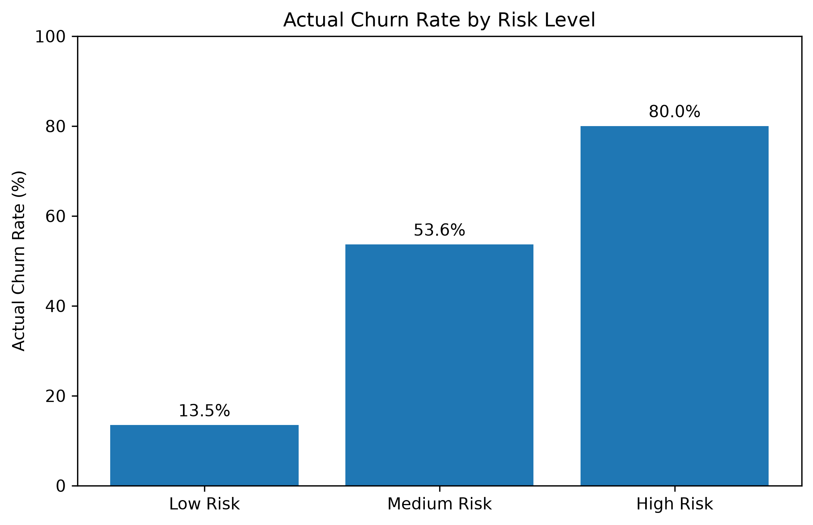
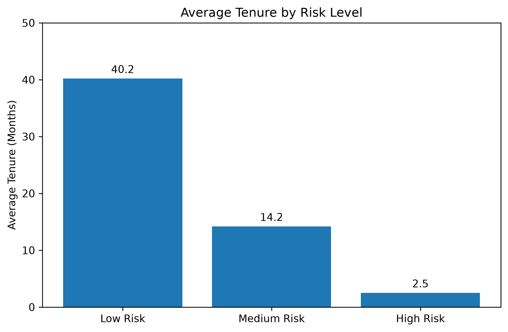
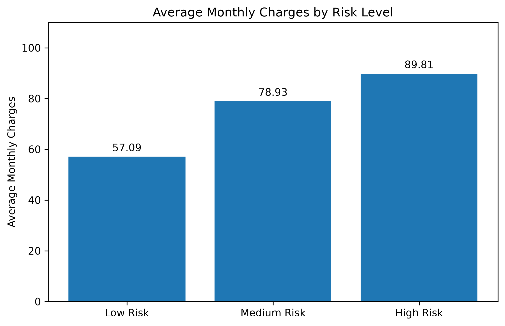
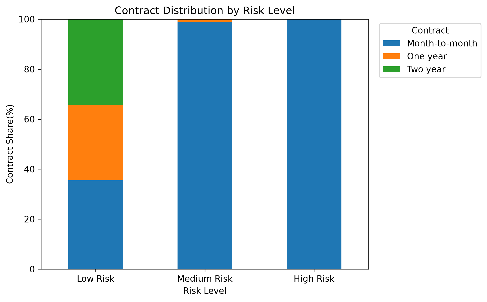

# Customer Churn Analysis and Retention Decision Support

**基于 Python 数据分析与机器学习的客户流失预测及留存决策支持项目**

> 本项目基于公开的 IBM Telco Customer Churn 数据集开展学习与实践，目标是从客户数据中识别流失风险、分析风险群体特征，并在模拟联系成本约束下评估留存优先级。**本项目不是企业真实部署，也不使用真实企业客户数据。**

## 1. 项目背景与目标

电信企业的客户留存资源通常有限。除了预测某位客户是否可能流失，业务人员还需要知道：哪些客户应该优先关注，预测名单有多准确，以及调整联系范围可能带来多少成本。

本项目围绕三个问题展开：

1. 哪些客户特征与流失情况、模型风险评分存在关联？
2. Logistic Regression 能否有效区分流失与未流失客户？
3. 当联系名额和干预成本有限时，如何制定**模拟**客户留存优先级？

## 2. 数据来源与技术栈

- **数据集：** [IBM Telco Customer Churn（Kaggle）](https://www.kaggle.com/datasets/blastchar/telco-customer-churn)
- **数据规模：** 7,043 名客户
- **核心建模特征：** `tenure`、`MonthlyCharges`、`Contract`、`InternetService`、`TechSupport`
- **编程语言：** Python
- **数据分析与可视化：** Pandas、NumPy、Matplotlib
- **模型与评估：** scikit-learn、Logistic Regression、Pipeline
- **开发环境：** VS Code、Jupyter Notebook、Anaconda

## 3. 项目结构

```text
customer-churn-analysis/
├── data/
│   ├── raw/                         # 原始数据
│   └── processed/                   # 清洗后的数据
├── notebooks/
│   ├── 01_data_audit.ipynb
│   ├── 02_exploratory_data_analysis.ipynb
│   ├── 03_retention_simulation.ipynb
│   └── 04_churn_prediction.ipynb
├── reports/
│   └── figures/                     # 分析图表（PNG）
├── environment.yml                  # Conda 环境配置
└── README.md
```

上述结构对应开发中的项目目录。运行时请以 Notebook 中实际使用的数据路径为准。

## 4. 项目实施流程

1. **数据审计与清洗：** 检查字段类型、缺失值和数据质量。
2. **探索性分析（EDA）：** 分析客户特征与流失现象之间的关联。
3. **客户留存模拟：** 探索联系成本、漏报机会成本与留存策略。
4. **模型训练：** 使用数据预处理 Pipeline 和 Logistic Regression 建立分类模型。
5. **模型评价：** 使用混淆矩阵、Precision、Recall、F1-score 和 ROC-AUC 理解不同评价维度。
6. **阈值比较：** 在验证集上比较 50% 和 40% 两个候选分类阈值。
7. **风险分层与优先级：** 按预测概率划分低、中、高风险，并按风险从高到低排序。
8. **可视化与业务解释：** 生成图表，解释观察结果和适用局限。

## 5. 模型训练与验证

### 5.1 数据划分

使用 `random_state=42` 和分层抽样（`stratify`），划分出：

| 数据集 | 客户数 | 主要用途 |
|---|---:|---|
| 训练集 | 4,225 | 学习模型参数 |
| 验证集 | 1,409 | 比较候选分类阈值 |
| 测试集 | 1,409 | 对固定方案进行回顾性评估 |

选择阈值后，最终模型使用原始训练部分（训练集与验证集，共 5,634 人）重新拟合。

### 5.2 验证集阈值比较

采用一个**演示用**成本函数：

```text
模拟总成本 = 10 × (TP + FP) + 25 × FN
```

即每名进入联系名单的客户产生 10 单位联系成本，每名遗漏的真实流失客户产生 25 单位模拟机会成本。该设定不是企业真实成本数据，也不等于实际留存投资回报。

| 验证集指标 | 阈值 50% | 阈值 40% |
|---|---:|---:|
| Precision | 65.4% | 58.6% |
| Recall | 50.0% | 65.5% |
| 模拟总成本 | 7,535 | **7,405** |

在**这两个候选阈值和当前模拟成本假设**下，40% 的验证集成本低 130 单位，因此选为后续分析阈值。不能据此证明 40% 是全局最优阈值。

### 5.3 最终模型的回顾性测试结果

| 指标 | 结果 |
|---|---:|
| 采用阈值 | 40% |
| Precision | 56.4% |
| Recall | 64.7% |
| TP（正确识别流失） | 242 |
| FP（误报流失） | 187 |
| FN（遗漏流失） | 132 |
| TN（正确排除） | 848 |
| 模拟总成本 | 7,590 |

**重要说明：** 在补充独立验证集之前，开发过程中已多次查看并比较过原测试集结果。因此，上述结果应被视为**回顾性／探索性测试结果**，不能宣称是完全未经查看的独立泛化评估。早期 80/20 实验记录的 ROC-AUC 为 0.8321，也不应直接当作这一最终流程重新测得的指标。

## 6. 客户风险分层与排序分析

在前期探索模型的测试集结果中，使用预测流失概率划分风险等级（教学演示边界）：

- **低风险：** 预测概率低于 40%
- **中风险：** 40% 至不足 70%
- **高风险：** 70% 及以上

| 风险组 | 客户数 | 实际流失率 | 平均在网时长（月） | 平均月费 |
|---|---:|---:|---:|---:|
| 低风险 | 980 | 13.5% | 40.2 | 57.09 |
| 中风险 | 384 | 53.6% | 14.2 | 78.93 |
| 高风险 | 45 | 80.0% | 2.5 | 89.81 |

在这一探索样本中，高风险组全部使用月付合同。**风险组特征属于模型评分与输入特征的关联性描述，不是导致流失的因果证据。**

### 前 100 名客户的模拟联系名单

将前期模型的测试集客户按预测流失概率降序排序：

| 指标 | 结果 |
|---|---:|
| 模拟联系名额 | 100 |
| 名单中实际流失客户 | 80 |
| Precision@100 | 80.0% |
| Recall@100 | 约 21.4% |
| 相对测试集整体流失率的 Lift@100 | 约 3.0 倍 |

该分析反映前期模型的**排序集中程度**，不应与后面重新拟合模型的 40% 分类阈值评估混为同一次实验；更不能把筛选命中率理解为实际挽留成功率。

## 7. 数据可视化

### 不同风险等级的实际流失率



### 不同风险等级的平均在网时长



### 不同风险等级的平均月费



### 不同风险等级的合同类型分布



## 8. 如何运行项目

1. 获取本项目代码和 IBM Telco Customer Churn 公开数据集；将原始 CSV 放在 Notebook 所引用的 `data/raw/` 路径下。
2. 使用 Anaconda 导入项目的 `environment.yml`（或在 Conda 终端执行 `conda env create -f environment.yml`）。
3. 使用 VS Code 打开项目根目录，选择对应的 Python / Jupyter 内核。
4. 按顺序查看并运行以下 Notebook：
   - `notebooks/01_data_audit.ipynb`
   - `notebooks/02_exploratory_data_analysis.ipynb`
   - `notebooks/03_retention_simulation.ipynb`
   - `notebooks/04_churn_prediction.ipynb`
5. 生成的图表可在 `reports/figures/` 目录查看。运行前请确认输入文件路径与本机目录一致。

**复现提示：** Notebook 含有早期探索实验与后续验证集实验，阅读指标时请注意对应的模型、数据划分及阈值；不应把不同阶段的结果直接混合比较。

## 9. 业务启示与项目局限

**业务启示：** 模型预测的高风险组呈现平均在网时间较短、月费较高、集中采用月付合同等特征。预测概率排序可以帮助企业在联系资源有限时建立优先关注名单，但实际策略还需要结合客户价值、可联系性、优惠成本及预期留存收益。

**局限性：**

- 所有分析基于公开历史数据，并未在真实企业客户上部署或开展干预实验。
- 模拟成本参数、40%/70% 风险分界及每周联系 100 人的名额均为演示假设。
- 过去曾查看测试集结果，当前报告不能声称提供严格未触碰测试集的最终验证。
- 预测客户会流失不等于预测客户会因优惠或联系而留下；特征关联也不能证明因果关系。
- 真正落地前，需要新时间段或其他独立样本进行验证，并检验成本假设、概率校准和干预效果。

## 10. 后续改进

可以在新的独立数据上评估泛化效果，系统比较多种模型与阈值，并逐步引入客户价值、干预成功概率和更符合真实场景的留存收益模型。